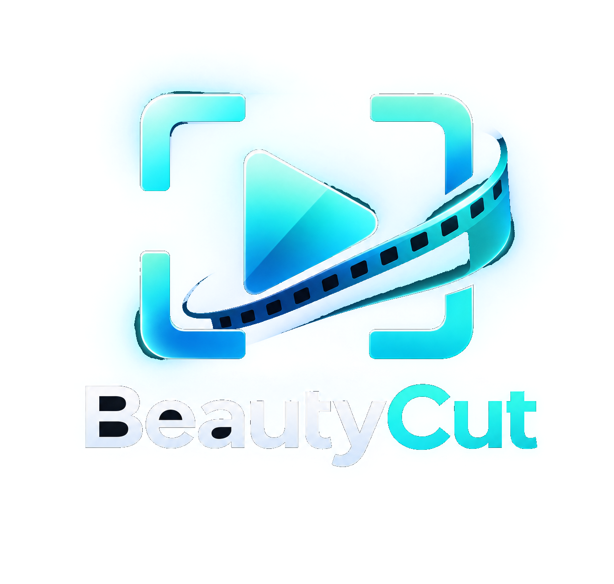

# ✦ BeautyCut

### Recadrez. Optimisez. Exportez.

**BeautyCut** est une application de bureau Windows dédiée au recadrage et à l'exportation vidéo en local. Pensée pour simplifier la préparation de contenus destinés aux réseaux sociaux, elle permet de transformer rapidement une vidéo en différents formats, sans compte, sans service distant et sans filigrane.

Développé par **Immersive Studio Corporation**, BeautyCut s'appuie sur FFmpeg et FFprobe pour offrir un traitement vidéo local, configurable et performant.

<p align="center">
  
</p>

<p align="center">
  <strong>100 % local · Sans filigrane · Formats multiples · Export configurable</strong>
</p>

---

## ✨ Fonctionnalités

### 🎬 Importation et analyse des médias

- Importation de vidéos et fichiers audio.
- Glisser-déposer ou sélection depuis l'explorateur Windows.
- Analyse automatique avec FFprobe.
- Détection du conteneur, de la durée et de la résolution.
- Identification de la cadence et des codecs.
- Détection des pistes audio et vidéo multiples.
- Vérification des décodeurs et encodeurs disponibles.

### 📐 Recadrage vidéo

Préparez vos vidéos pour différentes plateformes et proportions :

| Format | Ratio | Utilisation |
|---|---|---|
| Vertical | 9:16 | TikTok, Reels, Shorts, Stories |
| Portrait | 4:5 | Publications Instagram |
| Carré | 1:1 | Publications carrées |
| Paysage | 16:9 | Vidéos classiques |
| Personnalisé | Libre | Dimensions personnalisées |

Outils de cadrage disponibles :

- Déplacement direct du cadre à la souris.
- Neuf points d'ancrage rapides.
- Ajustement horizontal et vertical.
- Zoom réglable jusqu'à 200 %, également ajustable en glissant les poignées de recadrage.
- Recentrage et réinitialisation.
- Plusieurs modes de remplissage.
- Conservation de l'image entière avec bandes.
- Comparaison avant/après déplaçable entre l'image originale et le rendu réel de FFmpeg.
- Raccourcis : Ctrl+O pour importer, Ctrl+E pour exporter, Ctrl+R pour réinitialiser le cadrage et Ctrl+0 pour le centrer.

### ⚙️ Exportation configurable

BeautyCut propose plusieurs paramètres pour adapter les exports aux besoins de chaque utilisateur.

**Formats de sortie :**
- MP4
- MOV
- MKV
- WebM

**Qualité :**
- Qualité recommandée.
- Haute qualité.
- Fichier plus léger.
- Qualité personnalisée.

**Encodage :**
- Mode rapide.
- Mode équilibré.
- Mode orienté compression.
- Réglage de la qualité vidéo.
- Réglage du débit.
- Choix de la cadence de sortie.
- Sélection des codecs audio et vidéo.

BeautyCut utilise les encodeurs disponibles dans l'installation locale de FFmpeg, notamment NVIDIA NVENC lorsque celui-ci est compatible.

### 📊 Suivi des exportations

Gardez le contrôle sur vos traitements grâce aux informations de progression :

- Pourcentage d'avancement.
- Durée vidéo déjà traitée.
- Temps écoulé.
- Temps restant estimé.
- Vitesse de traitement.
- Taille du fichier généré.
- Annulation de l'exportation.

Une exportation annulée ne laisse pas de fichier de sortie partiel.

### ✂️ Découpage des vidéos longues

Préparez des vidéos en plusieurs parties numérotées.

- Préréglages TikTok.
- Préréglages Instagram Reels.
- Préréglages YouTube Shorts.
- Durée personnalisée de 1 seconde à 24 heures.
- Marge de sécurité d'une seconde par segment.
- Conservation des segments terminés en cas d'annulation.

### 🎨 Personnalisation

BeautyCut propose 20 thèmes visuels inspirés de la nature, des océans et du cosmos.

- Sélection du thème depuis l'interface.
- Mémorisation des préférences.
- Interface adaptée aux différentes dimensions de fenêtre.
- Aperçus réorganisés selon la largeur disponible.

### 🔄 Mise à jour automatique

BeautyCut intègre un système de mise à jour automatique :

1. Vérification de la version disponible au démarrage.
2. Téléchargement de la nouvelle version.
3. Vérification de l'empreinte SHA-256.
4. Installation automatique.
5. Redémarrage de l'application.

---

## 🖥️ Configuration requise

| Élément | Configuration |
|---|---|
| Système | Windows 10 / 11 |
| Architecture | x64 |
| Python | 3.10 ou supérieur |
| Interface | PySide6 |
| Traitement vidéo | FFmpeg |
| Analyse média | FFprobe |

**Dépendances principales :**
- Python
- PySide6
- FFmpeg
- FFprobe

Les encodeurs et décodeurs disponibles dépendent de la compilation locale de FFmpeg.

Pour bénéficier de l'accélération matérielle NVIDIA, une carte compatible, un pilote adapté et une compilation FFmpeg avec NVENC sont nécessaires.

---

## 🚀 Installation

### Depuis les sources

Cloner le dépôt :

```powershell
git clone https://github.com/Immersive-Studio-Corporation/Beautycut.git

cd Beautycut
```

Créer un environnement virtuel :

```powershell
py -3 -m venv .venv

.\.venv\Scripts\Activate.ps1
```

Installer les dépendances :

```powershell
python -m pip install --upgrade pip

python -m pip install -e .
```

Lancer BeautyCut :

```powershell
python -m beautycut
```

### Configuration de FFmpeg

FFmpeg et FFprobe doivent être accessibles depuis le PATH, présents dans le dossier `bin` du projet ou configurés explicitement.

Exemple PowerShell :

```powershell
$env:BEAUTYCUT_FFMPEG = 'C:\Outils\ffmpeg\bin\ffmpeg.exe'

$env:BEAUTYCUT_FFPROBE = 'C:\Outils\ffmpeg\bin\ffprobe.exe'

python -m beautycut
```

---

## 📦 Compilation Windows

BeautyCut peut être compilé sous forme d'application Windows autonome.

### Générer l'application

```powershell
.\scripts\build_windows.ps1
```

Les fichiers compilés sont générés dans :

```text
dist/
└── BeautyCut/
```

### Générer l'installeur

Après installation d'Inno Setup :

```powershell
.\scripts\build_windows.ps1 -BuildInstaller
```

L'installeur est généré dans :

```text
dist/
└── installer/
```

FFmpeg et FFprobe doivent toujours être disponibles sur l'ordinateur cible.

---

## 🛠️ Technologies utilisées

| Technologie | Utilisation |
|---|---|
| Python | Langage principal |
| PySide6 / Qt | Interface graphique |
| FFmpeg | Traitement et exportation vidéo |
| FFprobe | Analyse des médias |
| PyInstaller | Compilation Windows |
| Inno Setup | Création de l'installeur |
| GitHub Actions | Automatisation des publications |

### Architecture du projet

```text
Beautycut/
│
├── assets/
│   ├── beautycut_logo.png
│   ├── beautycut_mark.png
│   └── beautycut_mark.ico
│
├── beautycut/
│   ├── app.py
│   │
│   ├── gui/
│   │   └── Interface, widgets et tâches Qt
│   │
│   └── media/
│       ├── probe.py
│       ├── export.py
│       └── tools.py
│
├── tests/
│
├── scripts/
│   └── build_windows.ps1
│
├── packaging/
│   └── BeautyCut.iss
│
├── updates/
│   └── latest.json
│
├── pyproject.toml
├── README.md
└── LICENSE
```

---

## 🧪 Tests

Les tests automatisés vérifient notamment :

- La création de médias de test avec FFmpeg.
- L'analyse des pistes avec FFprobe.
- La gestion de plusieurs pistes audio.
- Le fonctionnement du recadrage.
- La validité des exports générés.

Exécuter les tests :

```powershell
python -m unittest discover -s tests -v
```

---

## 🗺️ Feuille de route

BeautyCut est conçu pour évoluer progressivement vers une solution plus complète de préparation et de montage vidéo.

| Fonctionnalité | État |
|---|---|
| Importation et analyse des médias | Disponible |
| Recadrage vidéo statique | Disponible |
| Formats personnalisés | Disponible |
| Exportation FFmpeg | Disponible |
| Gestion des pistes audio | Disponible |
| Découpage en segments | Disponible |
| Accélération NVIDIA NVENC | Selon installation |
| Lecteur vidéo intégré | À venir |
| Timeline de montage | À venir |
| Déplacement et assemblage des clips | À venir |
| Gestion avancée des pistes audio | À venir |
| Texte et transitions | À venir |
| Recadrage intelligent | À venir |
| Détection locale des visages et sujets | À venir |

Les fonctionnalités indiquées comme à venir ne sont pas encore disponibles dans la version actuelle.

---

## 🔐 Confidentialité et traitement local

BeautyCut privilégie le traitement local des médias.

- Aucun compte utilisateur nécessaire.
- Aucun service de stockage vidéo distant.
- Aucun téléversement de média vers un serveur de traitement.
- Aucun filigrane ajouté aux exportations.
- Traitement effectué avec les outils FFmpeg et FFprobe installés localement.

Le système de mise à jour automatique utilise néanmoins une connexion HTTPS pour vérifier et télécharger les nouvelles versions.

---

## 📄 Licence

BeautyCut est distribué sous licence **MIT**.

Consultez le fichier [LICENSE](LICENSE) pour connaître les conditions d'utilisation et de redistribution.

FFmpeg, FFprobe, PySide6 et les autres composants tiers conservent leurs propres licences. Les conditions de redistribution doivent être vérifiées séparément.

---

## 🏢 Développement

**BeautyCut** est un projet développé par **Immersive Studio Corporation**.

🌐 Site : https://immersive-studio.fr

💻 GitHub : https://github.com/Immersive-Studio-Corporation

📦 Dépôt BeautyCut : https://github.com/Immersive-Studio-Corporation/Beautycut

---

<p align="center">
  <strong>BeautyCut</strong>
  <br>
  <em>Transformez vos vidéos, en local.</em>
  <br><br>
  © 2026 Immersive Studio Corporation
</p>
